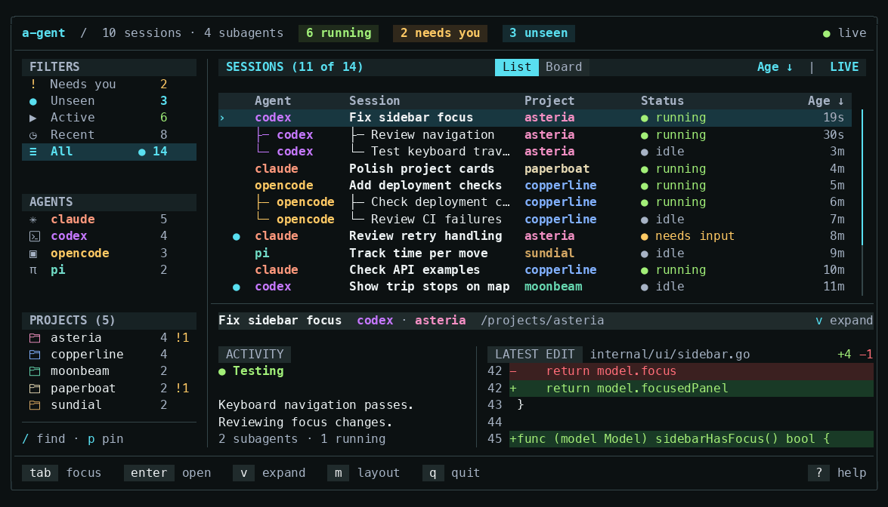

<h1 align="center">
  a-gent
</h1>

<p align="center">
  <a href="https://github.com/hexaquarks/a-gent/actions/workflows/tests.yml"></a>
  <a href="https://app.codecov.io/gh/hexaquarks/a-gent"></a>
  <a href="go.mod"></a>
</p>

a-gent is a small terminal dashboard for keeping track of your favorite coding
agents across projects. See which agents are working or waiting for you, preview
their activity and file edits, and jump to their tmux panes.

<p align="center">
  
</p>

## Supported adapters

<p align="center">
  <a href="https://github.com/openai/codex"></a>
  <a href="https://github.com/anthropics/claude-code"></a>
  <a href="https://github.com/anomalyco/opencode"></a>
  <a href="https://github.com/badlogic/pi-mono/tree/main/packages/coding-agent"></a>
  <a href="https://github.com/NousResearch/hermes-agent"></a>
</p>

Install the agents you use through the links above and make their commands
available on your `PATH`:

| Adapter | Command | Compatibility |
| --- | --- | --- |
| Codex | `codex` | Sessions launched with `--no-daemon` are not shown. |
| Claude Code | `claude` | Must support `claude agents --json`. |
| OpenCode | `opencode` | — |
| Pi | `pi` | — |
| Hermes | `hermes` | — |

Sessions are discovered automatically, including those started from a shell.
All five adapters support activity and edit previews, and launching a new
interactive instance in a tmux pane or window from the dashboard.

> [!IMPORTANT]
> a-gent automatically installs the OpenCode and Hermes plugins and the Pi
> extension. After your first launch, restart existing OpenCode and Hermes
> sessions; in Pi, run `/reload` or restart.

> [!NOTE]
> Pi shows running or idle; it cannot identify approval prompts from extensions.

## Install

Requires Go 1.24 or newer and Make:

```sh
git clone https://github.com/hexaquarks/a-gent.git
cd a-gent
make install
```

> [!TIP]
> The binary is installed to `~/.local/bin`. Add that directory to your `PATH`,
> or choose another destination with `make install BIN_DIR=/path/to/bin`.

## Usage

```sh
a-gent
```

Inside tmux, the dashboard opens in a popup. Select a session and press Enter to
jump to its matching tmux pane. Outside tmux, it runs directly in your terminal.

- Press Tab to switch between the sidebar and sessions; use `j`/`k` or the arrow
  keys to browse.
- Use the sidebar to filter by project, provider, or session state. Press Enter
  to apply a filter.
- Press `/` to search projects and `p` to pin or unpin a project in the sidebar.
- Press `s` to change the sort column or `S` to reverse it.
- Press `n` to launch an agent in a new tmux pane, or `N` for a new window.
- Press `v` to expand the preview and Escape to return; press `q` to quit.

## Local development

Run directly from the checkout:

```sh
make run
```

## Tests

Run formatting checks, unit tests, and static analysis:

```sh
make check
```

Run the terminal integration tests with tmux installed:

```sh
make test-integration
```
